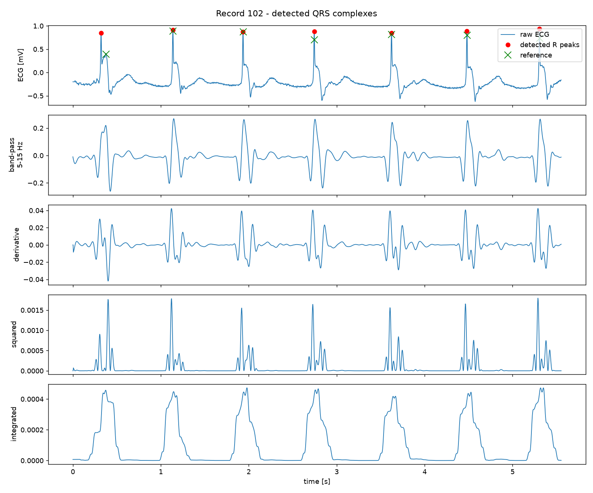

# Pan-Tompkins QRS detector

A Python implementation of the Pan-Tompkins algorithm for finding R peaks in an ECG, tested on two records from the MIT-BIH Arrhythmia Database.

I wrote this for a biosignal processing course. The goal was to build the detector from the paper without a ready-made library, check it against the cardiologist annotations, and see what breaks. The code is short and readable on purpose, so it should be easy to follow next to the paper.



*The top panel shows the raw ECG, detected R peaks (red) and the reference annotations (green). The panels below show what the signal looks like after each stage.*

## How it works

The pipeline follows the 1985 paper:

1. **Band-pass, 5-15 Hz.** Two windowed-sinc FIR filters (Hamming window, 101 taps): a low-pass at 15 Hz, and a high-pass at 5 Hz made by spectral inversion. The filters are symmetric, so the delay is constant and gets compensated, and the output lines up with the input.
2. **Derivative.** Five-point derivative, `y[n] = (-x[n-2] - 2x[n-1] + 2x[n+1] + x[n+2]) / 8`, to pick out the steep QRS slopes.
3. **Squaring.** Makes everything positive and boosts large slopes relative to small ones.
4. **Moving-window integration.** 150 ms window by default, which roughly covers one QRS complex.
5. **Adaptive thresholds.** Local maxima of the integrated signal at least 200 ms apart are candidates. Running estimates of the signal and noise peak levels (`SPKI`, `NPKI`) set a threshold that follows the signal as its amplitude changes.
6. **Search-back.** If the gap since the last beat is more than 1.66x the recent average RR interval, the detector goes back through the rejected candidates and picks the largest one above a lower threshold.
7. **Peak refinement.** The integrated signal peaks somewhere inside the QRS, not on the R wave itself. Each detection is moved to the point of largest deviation from the local baseline in the raw ECG, within +-75 ms.

A beat counts as detected if a detection falls within 75 ms of the reference annotation.

## Results

Record 102 is lead V5 and record 228 is lead MLII, both 30 minutes at 360 Hz. Integration window 150 ms.

| Record | Reference beats | Detected | TP | FP | FN | Sensitivity | Precision | MAE | STD |
|--------|----------------:|---------:|-----:|---:|---:|------------:|----------:|--------:|--------:|
| 102 | 2187 | 2187 | 2173 | 14 | 14 | 99.36% | 99.36% | 3.30 ms | 8.39 ms |
| 228 | 2053 | 2030 | 2021 | 9 | 32 | 98.44% | 99.56% | 2.45 ms | 7.69 ms |

MAE and STD are the mean absolute error and standard deviation of the timing difference between detected and reference R peaks, over matched beats.

### Integration window experiment

I also tried a few window lengths (`python main.py --window-experiment`):

| Window | 102: FP / FN | 228: FP / FN |
|-------:|-------------:|-------------:|
| 50 ms | 10 / 10 | 8 / 31 |
| 100 ms | 9 / 9 | 8 / 41 |
| 150 ms | 14 / 14 | 9 / 32 |
| 200 ms | 14 / 14 | 9 / 38 |
| 300 ms | 452 / 14 | 510 / 57 |

Between 50 and 200 ms there is no clear winner, and the differences are small. At 300 ms the number of false positives jumps to several hundred. I didn't track down exactly why. My guess is that a window that wide smears the QRS and the following T wave together and throws off the threshold estimates, but I haven't verified that.

Both records are hard on purpose. 102 has a demand pacemaker and multiform PVCs. 228 has multiform PVCs and three short stretches of tape slippage, according to the notes shipped with the data (`data/*_notes.txt`).

## Running it

You need Python 3 and three packages. I developed it on Python 3.14.

```bash
git clone https://github.com/<your-username>/pan-tompkins-qrs-detector.git
cd pan-tompkins-qrs-detector
python -m venv .venv
source .venv/bin/activate        # on Windows: .venv\Scripts\activate
pip install -r requirements.txt
```

Run both records, print the metrics and open the plots:

```bash
python main.py
```

Other options:

```bash
python main.py --no-show                  # only print the metrics
python main.py --save-figures images      # write the plots as PNG files
python main.py --window-experiment        # run the window-length comparison too
python main.py --data-dir path/to/data    # use a different data folder
```

A full run, including the window experiment, takes a few seconds.

Tests (synthetic ECG and the evaluation logic):

```bash
pip install -r requirements-dev.txt
pytest
```

### Using it from your own code

```python
from pan_tompkins import load_signal, load_annotations, detect_r_peaks, evaluate

ecg = load_signal("data/102_V5.dat")
reference = load_annotations("data/102_attr.dat")

detection = detect_r_peaks(ecg, fs=360)
print(detection.r_peaks[:5])        # sample indices of the first R peaks

metrics = evaluate(detection.r_peaks, reference, fs=360)
print(metrics.sensitivity, metrics.precision)
```

`detect_r_peaks` returns a named tuple with the R peak indices and also the intermediate signals (`filtered`, `derivative`, `squared`, `integrated`), which is handy for plotting.

## Project layout

```
.
├── pan_tompkins.py        the algorithm: filters, detector, evaluation
├── plots.py               detection plot and filter response plot
├── main.py                command line entry point
├── tests/                 pytest tests
├── data/                  two MIT-BIH records with annotations
├── images/                figures used in this README
├── requirements.txt
└── requirements-dev.txt
```

## Limitations

- **Offline only.** The filtering uses `mode="same"` on the whole recording, which looks at samples after the current one. The thresholds are adaptive like in the paper, but this is not a causal real-time implementation.
- **Single lead.** Each record is processed one lead at a time.
- **Two records.** Everything here was looked at on just two recordings, so don't read the numbers as a general claim about the algorithm. There was no separate set to tune on or validate against.
- **Beat types are not separated.** Pacemaker beats, PVCs and normal beats all count the same in the evaluation.
- **Fixed filter design.** The 5-15 Hz band and the 101-tap length are hard-coded as defaults. They suit 360 Hz data. At very different sampling rates you would want to revisit them.

## Data

The recordings come from the [MIT-BIH Arrhythmia Database](https://physionet.org/content/mitdb/1.0.0/) on PhysioNet, released under the Open Data Commons Attribution License v1.0. Only the two records used here are included:

| File | Content |
|------|---------|
| `102_V5.dat`, `228_MLII.dat` | one ECG sample per line, in mV, 360 Hz |
| `102_attr.dat`, `228_attr.dat` | reference annotations: sample index and beat label, tab separated |
| `102_notes.txt`, `228_notes.txt` | record notes and header information |

## References

- J. Pan and W. J. Tompkins, "A Real-Time QRS Detection Algorithm", *IEEE Transactions on Biomedical Engineering*, vol. 32, no. 3, pp. 230-236, 1985.
- G. B. Moody and R. G. Mark, "The impact of the MIT-BIH Arrhythmia Database", *IEEE Engineering in Medicine and Biology Magazine*, vol. 20, no. 3, pp. 45-50, 2001.
- A. L. Goldberger et al., "PhysioBank, PhysioToolkit, and PhysioNet: Components of a New Research Resource for Complex Physiologic Signals", *Circulation*, vol. 101, no. 23, pp. e215-e220, 2000.

## License

The code is released under the [MIT License](LICENSE). The data in `data/` has its own license, see above.
